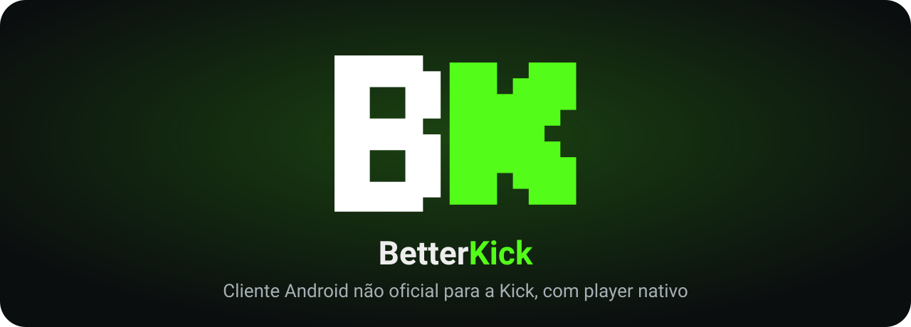

<p align="center">
  
</p>

<p align="center">
  <a href="https://github.com/carlosguilhe/BetterKick/releases/latest"></a>
  
  
  
  <a href="LICENSE"></a>
  
</p>

<p align="center">
  <a href="https://github.com/carlosguilhe/BetterKick/releases/latest"><b>⬇ Baixar a última versão</b></a>
  &nbsp;•&nbsp;
  <a href="#recursos">Recursos</a>
  &nbsp;•&nbsp;
  <a href="#perguntas-frequentes">Perguntas frequentes</a>
  &nbsp;•&nbsp;
  <a href="AVISO_LEGAL.md">Aviso legal</a>
</p>

---

**BetterKick** é um aplicativo Android **gratuito, sem anúncios e de código aberto** para assistir às lives da [Kick](https://kick.com) com um player nativo (ExoPlayer), pensado para manter a **qualidade estável** e a live **sem ficar pausando e voltando**.

> ⚠️ **Projeto independente e não oficial.** O BetterKick **não é afiliado, patrocinado nem aprovado pela Kick**. "Kick" e as marcas relacionadas pertencem aos seus respectivos donos. O app **não hospeda, não armazena e não redistribui** nenhum vídeo: ele apenas reproduz, no seu aparelho, os streams que a própria Kick já entrega para a sua conta. Leia o [aviso legal](AVISO_LEGAL.md).

## Recursos

### 🎬 Player
- **Qualidade automática estável**: sobe e desce com cuidado, sem oscilar. Dá para travar na máxima ou escolher 1080p60, 720p60, 480p, 360p ou 160p, e o app **lembra a escolha por canal**.
- **Distância do ao vivo** ajustável: baixa (4 s), equilibrada (10 s) ou estável (20 s).
- Etiqueta **AO VIVO** que vira **VOLTAR AO VIVO** quando você está atrasado, e tempo de live ("ao vivo há…").
- **Só áudio**, **timer para dormir** e **estatísticas** de reprodução.
- **Mini player** arrastável (arraste para fora ou toque no X para fechar), **Picture-in-Picture** e **áudio em segundo plano** com controles na notificação.
- **Chat** abaixo do vídeo, ao lado (paisagem) ou **sobre o vídeo**, com gestos de brilho e volume na tela cheia.
- **Reconexão automática** quando a internet cai e volta.

### 👤 Conta e social
- Login pela página da Kick (inclusive com Google).
- **Seguindo** com preview ao vivo, busca e filtros (Todos, Ao vivo, Offline).
- **Seguir e deixar de seguir** pelo player ou segurando o card de um canal.
- **Favoritos** e **avisos de live** (de quem você segue e dos favoritos), com opção de silenciar canais.
- **Histórico de lives** e recomendações "para você".

### 🔎 Descobrir
- Início com **Em alta agora**, categorias populares e mais lives, por idioma.
- **Busca** de canais e categorias, com histórico e filtros.
- **Página do canal** com **clipes** e **transmissões anteriores**.

### 🎨 Interface
- Barra de navegação **flutuante com desfoque**, tema **escuro, claro ou do sistema**, atalhos no ícone do app e tela de boas-vindas.
- Funciona com o **cache** das listas quando você está sem internet.

## Instalar

1. Baixe o `BetterKick-x.y.apk` mais recente em **[Releases](https://github.com/carlosguilhe/BetterKick/releases/latest)**.
2. Abra o arquivo no celular (Android 8.0 ou superior) e permita instalar apps desconhecidos quando o Android pedir.
3. Pronto. As próximas versões chegam pelo próprio app: **Configurações → Atualizações → Procurar atualização**. O app também confere sozinho de tempos em tempos.

O BetterKick **não está em nenhuma loja de apps**. Só baixe pelos Releases deste repositório.

### Conferir se o APK é autêntico
Todas as versões são assinadas com a mesma chave. A impressão digital (SHA-256) do certificado é:

```
28:17:7D:BC:B4:58:01:11:F9:B4:3D:61:42:72:54:8E:17:EC:99:67:02:E7:4C:91:8E:11:FC:3B:88:94:3C:18
```

Para conferir no computador: `apksigner verify --print-certs BetterKick-x.y.apk`.

## Perguntas frequentes

**É pago? Tem anúncio?**
Não. É gratuito, não tem anúncios, não cobra nada e não pede doação. Se alguém tentar vender este app, não é a gente.

**Preciso de conta na Kick?**
Para assistir às lives, não. Para ver quem você segue, seguir canais, receber avisos e escrever no chat, sim: você entra com a sua própria conta.

**É seguro? Vocês veem a minha senha?**
O login acontece na página da própria Kick, dentro do app. O BetterKick não vê nem guarda a sua senha; só mantém no aparelho a sessão que a Kick devolve. Veja a [política de privacidade](PRIVACIDADE.md).

**Pode quebrar?**
Pode. O app usa endereços não documentados do site da Kick, que podem mudar sem aviso. Se isso acontecer, o app mostra "A Kick pode ter mudado algo no servidor" e é preciso esperar uma atualização.

**O app baixa ou grava lives?**
Não. Não existe recurso de download, gravação ou compartilhamento de vídeo.

**Posso escrever no chat?**
Sim, quando você está logado. O chat é o da própria Kick, exibido dentro do app.

## Como funciona (resumo)

O app consulta os mesmos endereços públicos que o site da Kick usa, pega o endereço de reprodução (HLS) da live e o entrega ao [ExoPlayer](https://developer.android.com/media/media3), que toca direto dos servidores da Kick no seu aparelho. Não há servidor do BetterKick no meio: nada passa por nós.

## Compilar

Requisitos: JDK 17 e o Android SDK.

```
./gradlew assembleRelease
```

A assinatura de release lê um `keystore.properties` que fica **fora** do repositório. Sem ele, o build usa a chave de debug. Pacote: `com.newkick.app`.

## Tecnologias

Kotlin • Jetpack Compose • Media3 (ExoPlayer, HLS, MediaSession) • OkHttp • Coil • WorkManager • [Haze](https://github.com/chrisbanes/haze) (desfoque). Fonte dos títulos: [Press Start 2P](https://fonts.google.com/specimen/Press+Start+2P) (SIL Open Font License 1.1).

## Aviso legal, privacidade e licença

- 📄 [**Aviso legal**](AVISO_LEGAL.md): sem afiliação, marcas, conteúdo de terceiros e pedidos de remoção.
- 🔒 [**Privacidade**](PRIVACIDADE.md): o que o app guarda e com quem ele conversa.
- ⚖️ [**Licença MIT**](LICENSE): o código é livre, **sem nenhuma garantia**.

Se você é a Kick, um criador de conteúdo ou titular de direitos e acredita que algo aqui deve ser removido, abra uma [issue](https://github.com/carlosguilhe/BetterKick/issues) ou fale com [@carlosguilhe](https://github.com/carlosguilhe). Veja como no [aviso legal](AVISO_LEGAL.md#pedidos-de-remoção).
